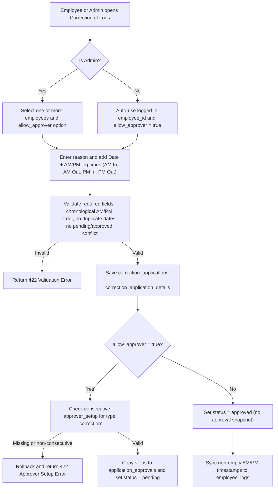
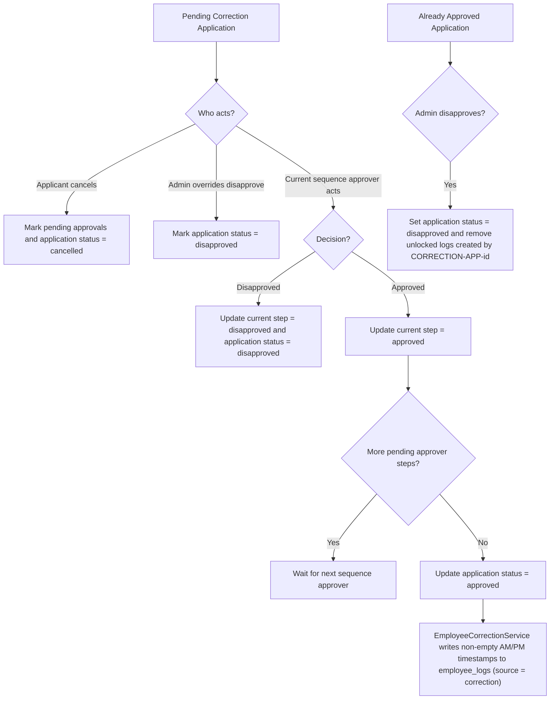

# Correction of Logs — Backend Process

Build the Correction of Logs online application flow, following the approval and detail structure used by Overtime and Official Business Applications, and pairing AM/PM log entries per date just like Manual Attendance Logs.

## Tables

### correction_applications

```text
id
employee_id
reason
status
submitted_at
created_at
updated_at
```

Status:

```text
pending
approved
disapproved
cancelled
```

### correction_application_details

```text
id
correction_application_id
date
am_in
am_out
pm_in
pm_out
created_at
updated_at
```

One application can have:
- multiple dates
- one AM/PM log row per date (any combination of AM In, AM Out, PM In, PM Out)

## Rules

```text
reason is required.
At least one date row is required, with no duplicate dates in the same application.
At least one log time (am_in, am_out, pm_in, or pm_out) is required per date row.
If both am_in and am_out are filled, am_out must be later than am_in.
If both pm_in and pm_out are filled, pm_out must be later than pm_in.
If both AM and PM times are filled on the same date, PM times must not be earlier than AM times.
A date cannot be filed if the employee already has a pending or approved correction application on that date.
Employee can only submit for themselves.
Admin can submit for one or multiple employees.
If approver flow is enabled, consecutive approver_setup for correction is required.
If auto-approved (allow_approver = false), status starts as approved with no approval snapshot and logs apply immediately.
```

Examples:

```text
Case 1 — Missed single punch (PM Out):
Date: 2026-11-16
AM In: —   AM Out: —
PM In: —   PM Out: 17:00
Reason: Biometric scanner was offline during dismissal

Case 2 — Missed full day / half-day punches:
Date: 2026-11-17
AM In: 08:00   AM Out: 12:00
PM In: 13:00   PM Out: 17:00
Reason: Power outage at branch office, manual DTR attached
```

## Submit Flow



## Approval, Sync & Cancel Flow



## Visibility & Access

```text
Menu code: correction_application (under Online Applications, path: /correction-applications)

View list / details:
- Admin → sees all correction applications
- Employee → sees own correction applications + correction applications where they are an assigned approver

Create:
- Employees can file their own correction of logs
- Admins can file correction of logs for one or multiple employees

Update (Approve / Disapprove / Cancel):
- Approve → current pending approver in sequence
- Disapprove → current pending approver or Admin override
- Cancel → applicant only, while status is pending
```

## Endpoints

| Method | Endpoint | Permission |
| --- | --- | --- |
| GET | `/api/correction-applications` | `correction_application:view` |
| GET | `/api/correction-applications/{application_id}` | `correction_application:view` |
| POST | `/api/correction-applications` | `correction_application:create` |
| POST | `/api/correction-applications/{application_id}/approve` | `correction_application:update` |
| POST | `/api/correction-applications/{application_id}/disapprove` | `correction_application:update` |
| POST | `/api/correction-applications/{application_id}/cancel` | `correction_application:update` |

## Important

```text
Register correction in Relation::morphMap so ApplicationApprovalService works automatically.
ApproverSetup::APPLICATION_TYPES already supports correction.
Support multi-status filtering and search across reason, date, employee, and approvers.
Approved correction entries sync to employee_logs via EmployeeCorrectionService so attendance processing picks them up automatically.
```
