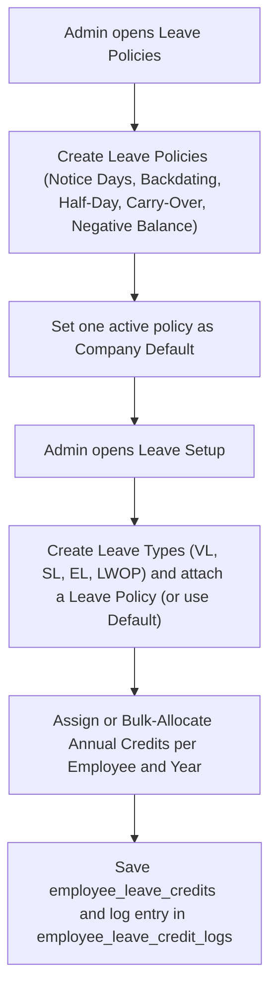
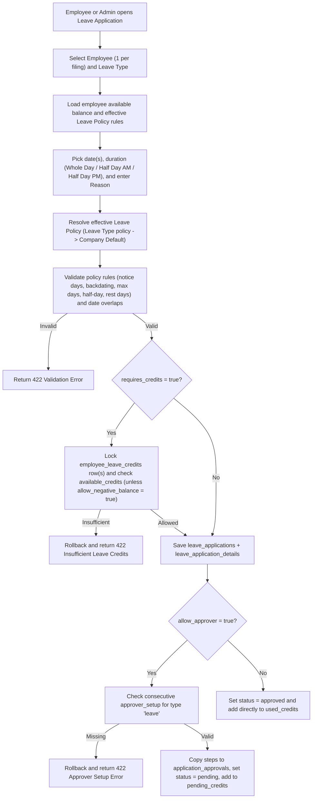
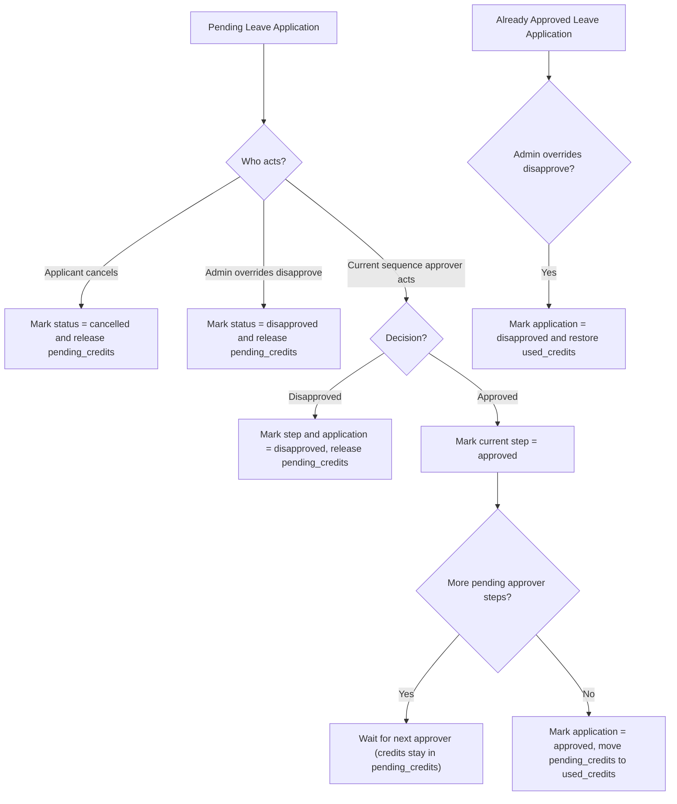

# Leave Policy, Leave Setup & Leave Application — Backend Process

Build the **Leave Policy**, **Leave Setup** (leave types & employee leave credits), and **Leave Application** (online application & approval) backend modules.

Follows the exact same policy architecture as **Attendance Policy** (`leave_policies` attached to `leave_types` with a company-wide `is_default` fallback) and reuses `ApproverSetup` (`application_type = leave`) + `ApplicationApprovalService`.

---

## Tables

### 1. leave_policies (Administration — Reusable Leave Rules)

```text
id
name                           (unique, e.g. Standard Leave Policy, Sick/Emergency Policy)
description                    (optional)
min_notice_days                (default 0 — days in advance required before leave date)
allow_backdated_filing         (true / false — whether past dates can be filed)
max_backdated_days             (nullable — max days in the past when backdating is allowed)
max_consecutive_days           (nullable — max days per single filing; null = unlimited)
allow_half_day                 (true / false — whether half_day_am / half_day_pm is allowed)
accrual_mode                   (upfront_annual, monthly_accrual, none)
allow_negative_balance         (true / false — allow filing beyond available credits)
carry_over_enabled             (true / false)
carry_over_max_days            (decimal 6,2 — max unused credits carried into next year)
count_rest_days                (true / false — whether scheduled rest days can be filed)
is_default                     (true / false — single company-wide fallback policy)
is_active                      (true / false)
created_at
updated_at
```

### 2. leave_types (Administration)

```text
id
code              (unique, e.g. VL, SL, EL, ML, PL, LWOP)
name              (e.g. Vacation Leave, Sick Leave, Emergency Leave, Leave Without Pay)
description       (optional)
leave_policy_id   (nullable FK -> leave_policies.id; falls back to default active policy)
is_paid           (true / false)
requires_credits  (true = checks & deducts balance; false = no credit limit)
default_credits   (default annual credit allocation, e.g. 15.00)
is_active         (true / false)
created_at
updated_at
```

### 3. employee_leave_credits (Per-Employee Annual Balance)

```text
id
employee_id
leave_type_id
year              (e.g. 2026)
allocated_credits (total credits granted for the year)
used_credits      (credits deducted by approved leaves)
pending_credits   (credits temporarily reserved by pending leaves)
created_at
updated_at
```

Available Balance Formula:

```text
available_credits = allocated_credits - used_credits - pending_credits
```

Unique constraint: `(employee_id, leave_type_id, year)`

### 4. employee_leave_credit_logs (Credit Audit Trail)

```text
id
employee_leave_credit_id
change_type          (grant, adjustment, reserve, deduct, release, restore)
amount               (+/- days, e.g. +15.00, -1.00, +0.50)
balance_after
leave_application_id (nullable)
remarks              (nullable)
acted_by             (nullable employee_id or user_id)
created_at
```

### 5. leave_applications (Online Application Header)

```text
id
employee_id
leave_type_id
date_from         (earliest date in details)
date_to           (latest date in details)
total_days        (sum of detail day_value, e.g. 1.00, 0.50, 2.50)
reason
status            (pending, approved, disapproved, cancelled)
submitted_at
created_at
updated_at
```

### 6. leave_application_details (Per-Date Breakdown)

```text
id
leave_application_id
date
duration_type     (whole_day, half_day_am, half_day_pm)
day_value         (1.00 for whole_day, 0.50 for half_day_am / half_day_pm)
created_at
updated_at
```

Unique constraint: `(leave_application_id, date)`

---

## Policy & Business Rules

### Leave Policy Invariants (mirrors Attendance Policy)

```text
Only one Leave Policy can have is_default = true at a time (locked in DB transaction).
A policy with is_default = true cannot have is_active = false.
A policy assigned to one or more leave_types cannot be deleted (returns 422).
If allow_backdated_filing = false, max_backdated_days must be null.
If allow_backdated_filing = true, min_notice_days must be 0.
If carry_over_enabled = false, carry_over_max_days must be 0.
Policy resolution for a leave type:
1. Assigned leave_type.leavePolicy (if present & active)
2. Company default LeavePolicy (is_default = true, is_active = true)
```

### Leave Application Validation Rules

```text
Leave type must be active.
Resolve effective LeavePolicy for the selected leave type.
Policy checks enforced on submit:
- Notice rule: if min_notice_days > 0, earliest leave date must be >= today + min_notice_days.
- Backdating rule: if allow_backdated_filing = false, no leave date may be before today; if true and max_backdated_days is set, no date may be older than today - max_backdated_days.
- Max days rule: if max_consecutive_days is set, total_days must be <= max_consecutive_days.
- Half-day rule: if allow_half_day = false, only whole_day is permitted.
- Rest-day rule: if count_rest_days = false, reject filing on a date marked as rest day in the employee's active schedule.
- Balance rule: if leave_type.requires_credits = true and policy.allow_negative_balance = false, employee must have enough available_credits for each year covered.

Duplicate & overlap rules:
- No duplicate dates inside the same leave application.
- Against existing pending or approved leaves of the same employee on the same date:
  - whole_day conflicts with whole_day, half_day_am, and half_day_pm.
  - half_day_am conflicts with whole_day and half_day_am (can pair with half_day_pm).
  - half_day_pm conflicts with whole_day and half_day_pm (can pair with half_day_am).

Ownership & approver rules:
- 1 employee per leave application (employee files for self; admin selects 1 employee).
- If allow_approver = true, consecutive approver_setup for type 'leave' is required.
- If allow_approver = false (admin auto-approve), status starts as approved and credits deduct directly into used_credits.
```

---

## Leave Policy & Credit Setup Flow



## Leave Application Submit Flow



## Approval, Disapproval, Cancel & Credit Sync Flow



---

## Visibility & Access

```text
Administration Menus:
1. leave_policy (under Administration, path: /leave-policies)
   - Admin only: CRUD leave policies & default policy management
2. leave_setup (under Administration, path: /leave-setup)
   - Admin only: CRUD leave types (linked to leave policies) & manage employee leave credits

Online Applications Menu:
3. leave_application (under Online Applications, path: /leave-applications)
   - View list / details:
     - Admin → sees all leave applications
     - Employee → sees own leave applications + leave applications where they are an assigned approver
   - Create:
     - Employees file their own leave and view their own balances & effective policy hints
     - Admins file leave for 1 employee at a time
   - Update (Approve / Disapprove / Cancel):
     - Approve → current pending approver in sequence
     - Disapprove → current pending approver or Admin override
     - Cancel → applicant only, while status is pending
```

---

## Endpoints

### Leave Policies (Administration)

| Method | Endpoint | Permission |
| --- | --- | --- |
| GET | `/api/leave-policies` | `leave_policy:view` |
| GET | `/api/leave-policies/{policy_id}` | `leave_policy:view` |
| POST | `/api/leave-policies` | `leave_policy:create` |
| PUT | `/api/leave-policies/{policy_id}` | `leave_policy:update` |
| DELETE | `/api/leave-policies/{policy_id}` | `leave_policy:delete` |

### Leave Types & Credits (Administration)

| Method | Endpoint | Permission |
| --- | --- | --- |
| GET | `/api/leave-types` | `leave_setup:view` (active options also returned with balances for `leave_application:view`) |
| POST | `/api/leave-types` | `leave_setup:create` |
| PUT | `/api/leave-types/{leave_type_id}` | `leave_setup:update` |
| DELETE | `/api/leave-types/{leave_type_id}` | `leave_setup:delete` |
| GET | `/api/employee-leave-credits` | `leave_setup:view` |
| POST | `/api/employee-leave-credits` | `leave_setup:create` |
| PUT | `/api/employee-leave-credits/{credit_id}` | `leave_setup:update` |
| POST | `/api/employee-leave-credits/allocate` | `leave_setup:create` (bulk allocate annual default credits) |

### Leave Applications (Online Applications)

| Method | Endpoint | Permission |
| --- | --- | --- |
| GET | `/api/leave-applications` | `leave_application:view` |
| GET | `/api/leave-applications/balances` | `leave_application:view` (returns active leave types, resolved policy rules, and employee balances) |
| GET | `/api/leave-applications/{application_id}` | `leave_application:view` |
| POST | `/api/leave-applications` | `leave_application:create` |
| POST | `/api/leave-applications/{application_id}/approve` | `leave_application:update` |
| POST | `/api/leave-applications/{application_id}/disapprove` | `leave_application:update` |
| POST | `/api/leave-applications/{application_id}/cancel` | `leave_application:update` |

---

## Important

```text
Register leave in Relation::morphMap so ApplicationApprovalService works automatically.
ApproverSetup::APPLICATION_TYPES already supports leave.
Approved leave impact on daily attendance (marking day as paid/unpaid leave instead of absent) will be consumed by EmployeeLeaveService during attendance processing.
All credit balance updates and default-policy toggles run inside DB transactions with lockForUpdate() to prevent race conditions.
```
